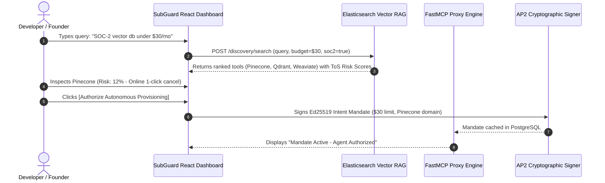
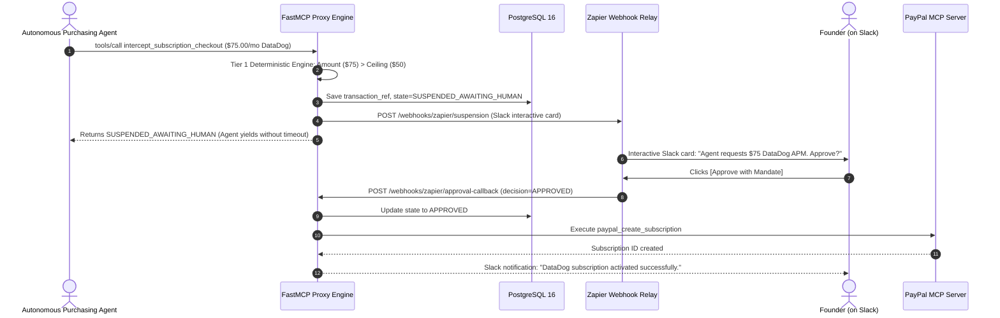
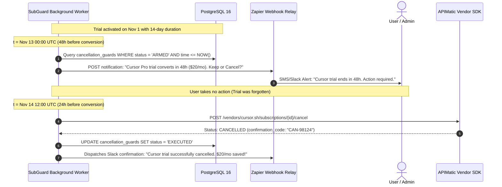

# SubGuard AI: Investor Pitch Deck & Product Walkthrough

**The Autonomous Financial Guardian for Digital Subscriptions & Agentic Commerce**  
**Document Version:** 1.0.0  
**Target Audience:** Angel Investors, Seed Venture Capitalists, Developer Tooling Partners  

---

```
                       ┌──────────────────────────────────────────────┐
                       │               SUBGUARD AI                    │
                       │   Autonomous Subscription Governance & RAG   │
                       └──────────────────────┬───────────────────────┘
                                              │
                    ┌─────────────────────────┴─────────────────────────┐
                    ▼                                                   ▼
       [ B2C & Micro-Startup Protection ]                 [ Agentic Commerce Guardrails ]
       - Zero-click cancellation loops                    - Cryptographic AP2 Mandates
       - Dark-pattern ToS risk radar                      - < 5ms deterministic engine
       - Multi-horizon visual timeline                    - Asynchronous Zapier HITL loop
```

---

## 📽️ The 12-Slide Investor Presentation

### Slide 1: Title & Executive Summary
* **Headline:** SubGuard AI — The Autonomous Financial Guardian for Digital Subscriptions
* **Tagline:** Discovery, Cryptographic Governance, and Auto-Cancellation for the Age of AI Agents.
* **The Opportunity:** Software subscriptions are the #2 operating expense in startups, yet 18–30% of spend is lost to "zombie" orphaned seats, hidden auto-renewals, and dark-pattern cancellations. With autonomous AI purchasing agents entering production, companies risk catastrophic runaway billing.
* **Our Solution:** A hybrid FastMCP proxy and intelligent dashboard that discovers SaaS tools, scores ToS legal risks, enforces deterministic spend limits in `<5ms`, and schedules automated cancellations before free trials convert into annual lock-ins.

---

### Slide 2: The Problem (Subscription Sprawl & Auto-Renewal Traps)
* **The Silent Burn:**
  - **Startups:** Ad-hoc provisioning across micro-teams creates redundant licenses (Zoom vs. Google Meet vs. Slack Huddles) and orphaned accounts when engineers transition.
  - **Consumers:** 85% of consumers report forgetting at least one recurring trial, resulting in unintended charges averaging \$130+/year per user.
* **The "Roach Motel" Phenomenon:**
  - One-click checkout, but six-step cancellation mazes, hidden cancellation phone lines, and artificial penalty fees designed to exploit customer inertia.
* **The Agentic Commerce Governance Vacuum:**
  - Autonomous agents (Claude Code, Devin, AutoGPT) are equipped with tool-calling access to credit cards. Without fine-grained guardrails, an agent tasked with "benchmarking 5 vector databases" can rack up thousands of dollars in unbounded monthly recurring charges.

---

### Slide 3: Market Size & Opportunity (The Overlooked SMB Gap)
* **Total Addressable Market (TAM):** \$310 Billion global SaaS market expanding to \$600B+ by 2030.
* **Serviceable Addressable Market (SAM):** \$42 Billion subscription management & procurement space.
* **Serviceable Obtainable Market (SOM):** \$6.8 Billion spend management market tailored for consumers, freelancers, and early-stage tech startups (sub-50 employees).
* **The Enterprise Spend Blind Spot:**
  - Enterprise platforms (Ramp, Brex, Coupa, Zip) require weeks of ERP integration and focus on post-charge credit card limits and multi-tiered purchase orders.
  - They provide **zero pre-authorization tool interception** for AI agents, **zero ToS dark-pattern analysis**, and **zero automated cancellation APIs**.

---

### Slide 4: The Product Solution (Hybrid MCP Proxy + AI Guardian)
* **Pre-Execution Interception:** Sits between autonomous purchasing agents and payment rails (PayPal MCP, vendor APIs). Intercepts checkout requests before financial commitment.
* **Three-Tier Policy Cascading:**
  1. **Tier 1 — Deterministic Engine (< 5ms):** Mathematical verification of monthly ceilings, per-transaction limits ($50 default), and merchant allowlists. 100% immune to prompt injection.
  2. **Tier 2 — Elastic Vector RAG (< 120ms):** Semantic search for software alternatives and natural-language Terms of Service (ToS) dark-pattern risk scoring.
  3. **Tier 3 — Asynchronous Human-in-the-Loop (HITL):** Suspends over-limit transactions, dispatches Slack/SMS approval webhooks via Zapier, and resumes seamlessly upon Ed25519 signature.

---

### Slide 5: Key Feature 1 — Semantic Discovery & ToS Risk Radar
* **Natural-Language Procurement:** Users and agents search conversational queries: *"Cheap SOC-2 vector database with Python SDK under \$30/month"*.
* **Elasticsearch k-NN Vector Search:** Ranked recommendations with real-time budget compatibility filtering and sub-120ms p95 latency.
* **Automated ToS Clause Parsing:** Scrapes and embeds vendor Terms of Service agreements to generate a `tos_risk_score` (0.0 to 1.0).
* **Dark-Pattern Warning Flags:** Flags mandatory phone cancellations, 60-day advance notice lock-ins, and disguised annual agreements billed monthly.

---

### Slide 6: Key Feature 2 — Virtual Trial Guardrails & Automated Cancellation
* **Orphaned Trial Immunity:** When a user or agent activates a free or discounted trial, SubGuard automatically registers a deterministic `cancellation_guard`.
* **The 48-Hour Guarantee:** Exactly 48 hours prior to trial conversion, SubGuard dispatches an omnichannel alert (Slack, SMS, email) with one-click extension.
* **Zero-Touch Automated Termination:** If the user does not explicitly choose to convert, SubGuard executes cancellation automatically via **APIMatic-generated SaaS SDK wrappers** or **PayPal MCP subscription cancellation** tools.

---

### Slide 7: Key Feature 3 — Interactive Telemetry Command Center
* **Dense Virtualized Financial Grid (AG Grid):**
  - Instant sorting, grouping, and filtering across 500+ active subscriptions at butter-smooth 60 FPS.
  - Live seat allocation tracking, normalized monthly burn rate calculations, and lifecycle badges (`ACTIVE`, `TRIAL_ACTIVE`, `SUSPENDED_AWAITING_HUMAN`).
* **Multi-Horizon Contract Timeline (Bryntum Scheduler):**
  - Visual Gantt-style horizontal timeline mapping 30/60/90-day cancellation notice windows, trial expiration countdowns, and scheduled auto-guard executions.
  - Interactive drag-to-reschedule capability allowing founders to adjust notification buffers with instant backend synchronization.

---

### Slide 8: System Architecture & Partner Technology Stack
* **Cloud Infrastructure:** **Render** hosting FastAPI/FastMCP proxy engine with managed PostgreSQL 16.
* **Semantic Discovery:** **Elasticsearch 8.x** vector search (k-NN) and dense ToS clause embeddings.
* **Frontend Visualization:** **React 18** with **AG Grid Enterprise** for virtualized tables and **Bryntum Calendar/Scheduler** for timeline telemetry.
* **Vendor API Wrapper Engine:** **APIMatic** generating strongly-typed cancellation SDKs from OpenAPI specs.
* **Out-of-Band Notification:** **Zapier** webhook relay for interactive Slack/SMS Human-in-the-Loop approvals.
* **Payment Rails & Cryptography:** **PayPal MCP Server** for native billing agreements + **AP2 (Agent Payments Protocol)** Ed25519 cryptographic mandates + **Skyfire KYA** identity lineage.

---

### Slide 9: Business Model & Unit Economics
* **Tiered Freemium SaaS Model:**
  1. **Consumer Free Tier (\$0/mo):** Up to 5 monitored subscriptions, manual cancellation instructions, and standard ToS risk scores. Drives high-velocity bottom-up user acquisition.
  2. **Prosumer & Solo Developer (\$5/mo):** Unlimited subscriptions, automated Zapier Slack alerts, and 3 automated cancellation guards per month.
  3. **Startup Team Tier (\$15/seat/month):** For companies managing up to \$20,000 in monthly software spend. Includes FastMCP proxy gateway, multi-agent AP2 mandate issuance, AG Grid/Bryntum command center, and unlimited automated cancellation guards.
  4. **Growth Tier (\$29/seat/month):** Custom ERP integrations, SOC-2 SIEM audit logs sync, and dedicated APIMatic custom vendor adapters.
* **Target Unit Economics:**
  - Gross Margin: **84%** (Leveraging efficient Render containers and deterministic engine caching).
  - Target CAC Payback: **4.2 months** via viral developer tool integrations and MCP ecosystem marketplaces.

---

### Slide 10: Defensibility & Competitive Moat
1. **The Proprietary Cancellation Graph:**
   - Powered by APIMatic, SubGuard maintains the industry's most comprehensive catalog of machine-executable SaaS cancellation workflows, covering thousands of SaaS vendors that lack public cancellation endpoints.
2. **Continuous ToS Dark-Pattern Intelligence:**
   - Elasticsearch continuously re-indexes vendor Terms of Service changes, alerting customers whenever a SaaS vendor quietly introduces stricter cancellation notice windows or price hikes.
3. **Cryptographic Protocol Standard (AP2 & KYA):**
   - Deep integration with the emerging Agent Payments Protocol (AP2) and Skyfire gives SubGuard first-mover dominance as the de-facto financial authorization proxy for autonomous agents.

---

### Slide 11: Go-to-Market Strategy (GTM)
* **Bottom-Up Developer Adoption:**
  - Package SubGuard as a standard FastMCP tool server on GitHub and MCP package registries. Developers building with Claude, Cursor, Devin, and LangChain install SubGuard with a single command (`npx subguard-mcp` or `pip install subguard`).
* **Micro-SaaS & Founder Communities:**
  - Targeted marketing across Product Hunt, Y Combinator Hacker News, and indie hacker forums focusing on the "Trial Trap Calculator" (free lead-generation tool).
* **Partner Co-Marketing:**
  - Launching in partnership with PayPal MCP ecosystem and developer tooling sponsors (Elastic, Render, Bryntum, AG Grid, APIMatic).

---

### Slide 12: Roadmap & Future Vision
* **Q1 2027 — Autonomous License Rebalancing:**
  - Automatically detect inactive seats (zero SSO logins in 30 days) and invoke APIMatic API wrappers to down-provision unused seats without human friction.
* **Q2 2027 — Multi-Agent Cross-Company Expense Pools:**
  - Shared AP2 budgetary vaults allowing collaborative swarms of agents across partner agencies to pool and allocate software costs securely.
* **Q3 2027 — Automated Price Optimization & Negotiation:**
  - AI agents benchmark competitor pricing in Elasticsearch and negotiate discounts directly with vendor sales bots at contract renewal time.

---

## 🧭 Documented UI/UX User Journey Flows

### Flow 1: Natural Language Discovery & Risk-Aware Procurement


---

### Flow 2: Over-Limit Interception & Asynchronous Slack Approval (HITL)


---

### Flow 3: Automated Trial Cancellation Guard Execution

