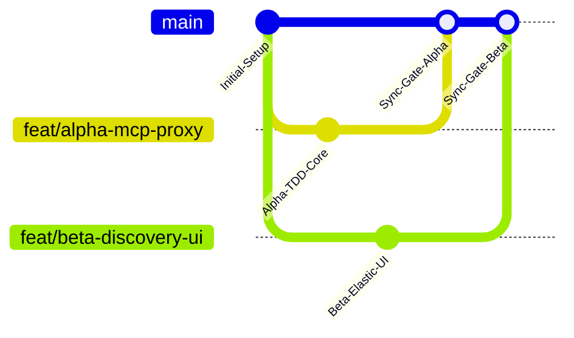

# Dual-Track Collaboration Protocol: Antigravity Pair-Programming

This protocol defines the strict operational rules for two engineers working concurrently with separate Antigravity instances on a shared repository.

---

## 1. Domain & Directory Isolation Rules

To eliminate file-locking conflicts and git merge collisions, the codebase is partitioned strictly into two orthogonal tracks. **No engineer may commit files in the other's domain.**

```
subguard/
├── core/                <- Owned by Track Alpha (Config, DB connections, crypto)
├── engine/              <- Owned by Track Alpha (Deterministic policy engine)
├── mcp_proxy/           <- Owned by Track Alpha (FastMCP proxy & request interceptor)
├── protocols/           <- Owned by Track Alpha (AP2 verifier, Skyfire KYA)
├── db/                  <- Owned by Track Alpha (PostgreSQL schemas, Alembic migrations)
├── discovery/           <- Owned by Track Beta (Elasticsearch vector client, ToS parser)
├── integrations/        <- Owned by Track Beta (APIMatic SDK wrappers, Zapier webhooks)
├── frontend/            <- Owned by Track Beta (React 18, AG Grid, Bryntum Calendar)
└── tests/
    ├── test_core/       <- Owned by Track Alpha (Unit & load tests for proxy/engine)
    ├── test_integrations/ <- Owned by Track Beta (Elastic & Zapier tests)
    └── mocks/           <- Owned by Track Beta (Mock servers & JSON-RPC fixtures)
```

### Ownership Summary:
* **Track Alpha (Engineer 1 - You):**
  * `subguard/core/`
  * `subguard/engine/`
  * `subguard/mcp_proxy/`
  * `subguard/protocols/`
  * `subguard/db/`
  * `tests/test_core/`
  * `pyproject.toml` & `uv.lock` (Root Python dependencies)
* **Track Beta (Engineer 2 - Teammate):**
  * `subguard/discovery/`
  * `subguard/integrations/`
  * `frontend/`
  * `tests/test_integrations/`
  * `tests/mocks/`
  * `frontend/package.json` & `frontend/package-lock.json`

---

## 2. The Single Source of Truth Principle (Contract-First)

1. The file [`workflow/contracts/API_CONTRACTS.md`](contracts/API_CONTRACTS.md) is the **immutable contract**.
2. **Track Beta does NOT block on Track Alpha's implementation.** Track Beta builds against the mock schemas and fixtures defined in `API_CONTRACTS.md`.
3. **Track Alpha does NOT alter schemas without written agreement.** If a field name, enum value, or return structure changes, both engineers must update `API_CONTRACTS.md` first before any code changes are written.

---

## 3. Git Branching & Synchronization Cadence



1. **Branch Naming**:
   * Track Alpha: `feat/alpha-<feature-name>` (e.g., `feat/alpha-mcp-proxy`, `feat/alpha-ap2-engine`)
   * Track Beta: `feat/beta-<feature-name>` (e.g., `feat/beta-discovery-ui`, `feat/beta-zapier-webhook`)
2. **Commit Policy**:
   * Push small, cohesive commits at the completion of each sub-module.
   * Run local linters (`ruff check . --fix`) and tests (`pytest`) before committing.
3. **Phase-End Merges**:
   * Merges to `main` occur only at designated **Phase Synchronization Checkpoints**.
   * Track Alpha merges first, followed by Track Beta merging and running the integration check against `localhost:8000`.

---

## 4. Conflict Resolution Rules

If a merge conflict occurs in configuration or orchestration files (e.g. `render.yaml` or `.gitignore`):
1. **Infrastructure & Backend**: Track Alpha has authority on database connection strings, Python runtime versions, and backend environment variables.
2. **Frontend & Integrations**: Track Beta has authority on static web build commands, node packages, and external API webhook configurations.
3. **Never resolve conflicts by commenting out tests or deleting contract definitions.**

---

## 5. Antigravity Context Isolation Rules

To prevent Antigravity context bleed, hallucinated code drift, or token exhaustion:
1. When starting a new phase, **clear terminal buffers** and feed only the specific prompt markdown for that phase.
2. In Phase 4 (Implementation), prompt Antigravity to **only inspect `API_CONTRACTS.md` and the current phase instructions**. Do not feed conversation history from Phase 1 or 2 into the implementation prompt.
3. Maintain `PROGRESS.md` in the project root as the live tracker of passing tests and module milestones.
