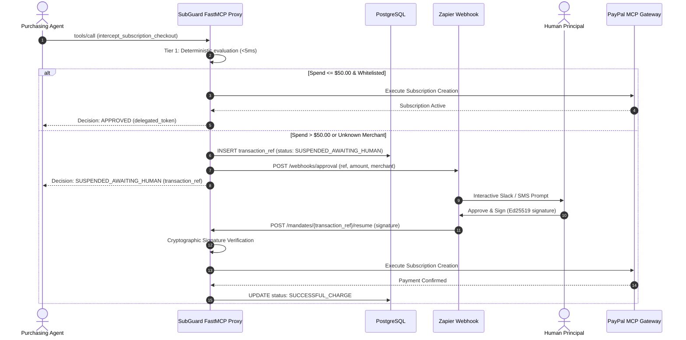

# System Architecture Specification: SubGuard AI

## 1. System Vision & Positioning
SubGuard AI is an autonomous subscription discovery, lifecycle governance, and cancellation platform tailored for consumers and early-stage startups.

Whereas enterprise spend solutions (Ramp, Zip, Coupa) emphasize multi-tiered purchase order workflows and ERP accounting reconciliations, SubGuard targets:
1. **Subscription Sprawl & Orphaned Seats**: Redundant software tools (e.g. Zoom vs Slack Huddles vs Google Meet).
2. **Auto-Renewal Traps & Dark Patterns**: Free trials turning into expensive recurring charges without pre-renewal consent.
3. **Agentic Commerce Guardrails**: Autonomous developer and workflow agents executing software purchases without bounded financial caps.

---

## 2. Component Architecture Overview

```
                      ┌──────────────────────────────────────────────┐
                      │             Client UI & Dashboard            │
                      │     (React 18 + AG Grid + Bryntum Calendar)  │
                      └──────────────────────┬───────────────────────┘
                                             │ HTTP / WebSocket
                                             ▼
                      ┌──────────────────────────────────────────────┐
                      │          SubGuard MCP Proxy Engine           │
                      │         (FastAPI / Hosted on Render)         │
                      └───────┬──────────────┬──────────────┬────────┘
                              │              │              │
              ┌───────────────┴──────┐       │       ┌──────┴──────────────────────┐
              ▼                      ▼       │       ▼                             ▼
     ┌─────────────────┐   ┌──────────────┐  │ ┌──────────────┐          ┌────────────────────┐
     │   Elastic RAG   │   │Deterministic │  │ │PayPal Remote │          │   Skyfire / AP2    │
     │ (Discovery/ToS) │   │Policy Engine │  │ │  MCP Server  │          │    Mandate Auth    │
     └─────────────────┘   └──────────────┘  │ └──────────────┘          └────────────────────┘
                                             ▼
                                  ┌──────────────────────┐
                                  │ Zapier Webhook Relay │
                                  │ (Async HITL Approval)│
                                  └──────────────────────┘
```

---

## 3. Technology Integration Matrix

| Partner Tech | Role in SubGuard AI | Architecture Tier |
| :--- | :--- | :--- |
| **Render** | Cloud hosting for FastAPI orchestrator, MCP proxy, and managed PostgreSQL 16 database | Infrastructure / Backend |
| **Elasticsearch** | Vector search (k-NN) for tool discovery + ToS auto-renewal risk analyzer + SIEM tool-call audit logs | RAG / Discovery / Security |
| **AG Grid** | Dense, virtualized tabular dashboard showing active seats, burn rates, renewal dates, and pending suspensions | Frontend Analytics |
| **Bryntum** | Visual timeline scheduler and calendar displaying trial countdowns, renewal lock-ins, and notice windows | Frontend Calendar |
| **APIMatic** | Automatic generation of typed Python/TS client SDKs and tool definitions for third-party SaaS billing/cancellation APIs | Vendor Integration |
| **Zapier** | Asynchronous out-of-band notification relays and Human-in-the-Loop (HITL) approval buttons (Slack, SMS, email) | Notification / HITL |
| **Postman** | Schema contracts, test fixtures, AP2 validation suites, and automated Newman CI/CD regression runs | QA & Testing |
| **PayPal MCP Server** | Native tools for subscription management, billing agreement inspection, and dispute escalation | Payment Protocol |
| **AP2 & Skyfire** | Cryptographic Ed25519 mandate tokens, bounded spend commitments, and Know Your Agent (KYA) parent-child lineage | Payment Cryptography |

---

## 4. Key Architectural Patterns

### 4.1. Asynchronous Request Suspension Pattern
To eliminate client timeouts during human authorizations:
1. When an agent attempts a transaction exceeding the threshold (e.g., >$50.00/mo or unknown merchant), the FastMCP Proxy intercepts the call.
2. The proxy creates a `pending_mandate_id`, saves state in PostgreSQL, and returns `status: SUSPENDED_AWAITING_HUMAN`.
3. The proxy fires a Zapier webhook which posts an interactive button to Slack/SMS.
4. The user clicks Approve, signing with their Ed25519 private key.
5. Zapier calls `/mandates/{ref}/resume` with the signature.
6. The transaction resumes and completes execution against the payment gateway.



### 4.2. Tiered Policy Cascading
1. **Tier 1 (Deterministic Engine - <5ms)**: 100% of transactions pass through hard mathematical constraints (monthly budget ceiling, single transaction limit, blacklisted merchants, minimum trial duration). No LLM cost or latency.
2. **Tier 2 (Elastic RAG + ToS Risk Evaluator - <120ms)**: Evaluates Terms of Service and scraped cancellation policies if a subscription has auto-renewal clauses.
3. **Tier 3 (Human-in-the-Loop Interception)**: High-risk or over-limit transactions trigger the asynchronous approval loop.

### 4.3. Multi-Agent Down-Scoping (Skyfire KYA)
- Parent agents grant child sub-agents restricted tokens where `child.max_allowance <= parent.remaining_allowance`.
- Delegation depth is enforced in AP2 JWT claims (`delegation_depth: 1`).
