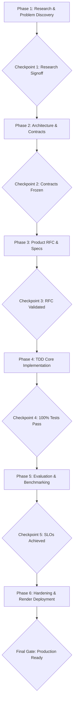

# Track Alpha: Core Engine & Protocols Guide
**Owner:** Engineer 1 (You)  
**Domain:** FastMCP Proxy, Deterministic Policy Engine, AP2 Mandate Verification, Skyfire KYA, PostgreSQL Persistence, Render Backend  

---

## 1. Track Overview & Responsibilities

You are responsible for the foundational brain, security boundaries, and payment governance of **SubGuard AI**. Your systems intercept agent tool calls, enforce spend limits in `<5ms`, cryptographically verify AP2 mandates, manage asynchronous human approvals, and route execution to PayPal and payment gateways.

### Directories You Exclusively Own:
* `subguard/core/` (Configurations, database connections, cryptographic key managers)
* `subguard/engine/` (Deterministic policy rules, mathematical spend clamps)
* `subguard/mcp_proxy/` (FastMCP server intercepting tool calls, suspension loops)
* `subguard/protocols/` (AP2 Ed25519 mandate verifiers, Skyfire token adapters)
* `subguard/db/` (PostgreSQL DDL, asyncpg repository models, Alembic migrations)
* `tests/test_core/` (Unit, security, and load tests for core engine)
* `pyproject.toml` and `uv.lock` (Python environment and backend dependencies)

---

## 2. Six-Phase Execution Workflow & Checkpoints

---

## 3. How to Use Your Prompt Series with Antigravity

Inside `workflow/track_alpha_core/prompts/`, you will find 6 numbered prompt files:
* `01_phase1_research_discovery.md`
* `02_phase2_architecture_contracts.md`
* `03_phase3_product_rfc.md`
* `04_phase4_core_implementation.md`
* `05_phase5_evaluation_benchmarks.md`
* `06_phase6_hardening_deployment.md`

### Standard Antigravity Session Protocol:
1. **Never copy the entire conversation history.** When advancing from one phase to the next, start fresh in Antigravity or clear your terminal buffer.
2. **Feed only the single phase prompt markdown.**
3. Run the phase verification command listed in [`CHECKPOINTS.md`](CHECKPOINTS.md) before moving to the next prompt.
4. Push your feature branch (`feat/alpha-*`) and sync with Track Beta at the designated merge gates.
