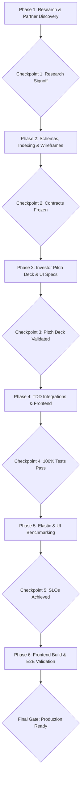

# Track Beta: Discovery, Integrations & Frontend Guide
**Owner:** Engineer 2 (Your Teammate)  
**Domain:** Elasticsearch Vector RAG, ToS Dark-Pattern Analyzer, APIMatic SDK Generation, Zapier Webhooks, React 18, AG Grid, Bryntum Calendar  

---

## 1. Track Overview & Responsibilities

You are responsible for how users and agents discover software, understand contract risks, visualize subscriptions, and handle out-of-band approvals. You build the natural-language search engine, parse Terms-of-Service clauses for dark patterns, auto-generate third-party SaaS cancellation SDKs, and build the interactive frontend dashboard.

### Directories You Exclusively Own:
* `subguard/discovery/` (Elasticsearch vector client, k-NN queries, ToS text indexer)
* `subguard/integrations/` (APIMatic generated SaaS API wrappers, Zapier webhook handlers)
* `frontend/` (React 18 app, AG Grid enterprise/community tables, Bryntum Calendar/Scheduler)
* `tests/test_integrations/` (Unit and integration tests for Elastic, Zapier, and ToS parsing)
* `tests/mocks/` (Mock server handlers and JSON-RPC fixtures for the FastMCP proxy)
* `frontend/package.json` and `frontend/package-lock.json` (Frontend Node dependencies)

---

## 2. Six-Phase Execution Workflow & Checkpoints

---

## 3. How You Build Without Waiting for Track Alpha (Contract-First Mocking)

1. Look at [`workflow/contracts/API_CONTRACTS.md`](../contracts/API_CONTRACTS.md).
2. The proxy endpoints and MCP tools are already fully defined.
3. In `tests/mocks/`, spin up a lightweight mock server or mock fixture returning the responses defined in `API_CONTRACTS.md`.
4. Build your React dashboard and Zapier callbacks against this mock. You **never** need to wait for Track Alpha to finish their backend before you can build and verify your entire frontend and discovery engine!

---

## 4. How to Use Your Prompt Series with Antigravity

Inside `workflow/track_beta_discovery_ui/prompts/`, you will find 6 numbered prompt files:
* `01_phase1_research_discovery.md`
* `02_phase2_indexing_and_wireframes.md`
* `03_phase3_pitch_deck.md`
* `04_phase4_integrations_frontend.md`
* `05_phase5_evaluation_benchmarks.md`
* `06_phase6_hardening_deployment.md`

### Standard Antigravity Session Protocol:
1. Start fresh in Antigravity or clear your terminal buffer before starting each phase.
2. Feed only the single markdown file for that phase.
3. Check off the requirements in [`CHECKPOINTS.md`](CHECKPOINTS.md).
4. Commit to your feature branch (`feat/beta-*`) and merge into `main` at designated checkpoints.
